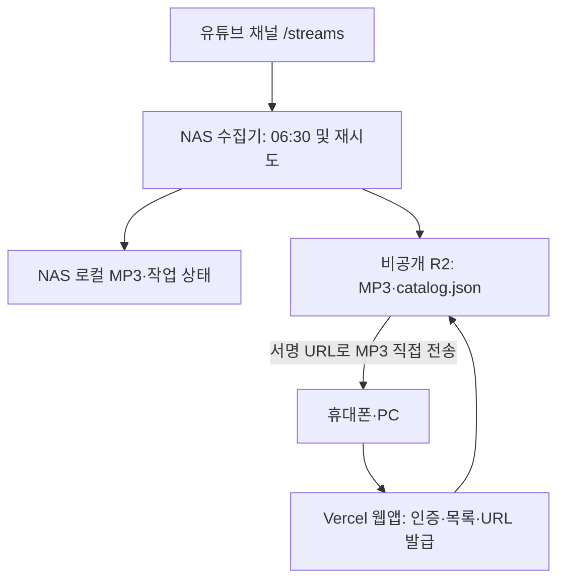

# 새벽예배 MP3 자동 수집·청취 서비스 — Codex 개발 인수인계

작성일: 2026-10-27 / 기준 시간대: Asia/Seoul

## 1. 다음 Codex에게 전달할 실행 지시

이 문서를 읽고 아래 서비스의 MVP 구현을 진행한다. 먼저 현재 저장소와 AGENTS.md, 구현된 기능, 실행 환경을 확인한다. 기존 코드가 있다면 보존하며 확장한다. 없다면 아래 권장 구조로 시작한다. 계획 설명에 그치지 말고 로컬에서 실행 가능한 웹앱과 NAS 수집기를 구현하고 핵심 테스트를 수행한다. 클라우드 자격 증명이 없어도 mock 데이터로 UI와 수집 상태 처리를 개발한다. 실제 연결·배포에 필요한 값은 .env.example과 운영 안내에 정리한다. 비밀값을 코드나 문서에 넣지 않는다.

사용자의 배포 대상은 Vercel이다. 다른 호스팅으로 임의 변경하지 않는다. 이 문서는 개발 인수인계이며 실제 설치·배포가 완료되었다는 기록이 아니다. 사용자의 공개 서비스 의도는 확인되지 않았으므로 접근 제어 없이 인터넷에 공개하지 않는다.

## 2. 목표와 현재까지의 상태

사용자는 Synology DS920+ NAS를 소유하고 있으며, 교회 유튜브 채널의 당일 새벽 방송을 매일 오전 06:30에 확인하여 MP3로 미리 받아두고, Vercel 웹페이지에서 듣거나 다운로드하고 싶어 한다.

대상 URL(사용자 제공):

https://www.youtube.com/@%EC%83%88%EA%B0%80%EB%82%98%EC%95%88%EA%B5%90%ED%9A%8C/streams

대화에서 설명한 구조:

- NAS: yt-dlp + FFmpeg + Deno로 수집·MP3 변환.
- Cloudflare R2 Standard: MP3와 목록 JSON 저장, 사용자에게 파일 직접 전달.
- Vercel / Next.js: 목록·재생·검색·접근 제어.
- 최초 MVP는 별도 원격 DB 없이 운영. NAS 내부 SQLite는 작업 상태 기록용으로 사용 가능.
- R2 다운로드 전송량에는 egress 요금이 없지만 저장량과 API 요청 수는 과금 대상이라는 점까지 사용자에게 설명했다.

실제 진행 상태:

- NAS용 Dockerfile, shell 수집 명령 및 DSM 예약 설정을 대화에서 안내했을 뿐 실제 설치·실행 여부는 확인되지 않았다.
- 채널 페이지 조회가 제한되어 실제 방송 메타데이터와 제목, 시작·종료 시각은 검증하지 못했다.
- R2 버킷, API 키, Vercel 프로젝트, Git 저장소, 웹앱 소스는 아직 제공되지 않았다.
- 이 인수인계 작성 과정에서 NAS·R2·Vercel을 변경하거나 다운로드 작업을 실행하지 않았다.

## 3. 확정 요구와 제안 기본값

| 항목 | 상태 | 내용 |
|---|---|---|
| NAS 기종 | 사용자 명시 | Synology DS920+ |
| 대상 채널 | 사용자 명시 | 위 /streams 주소 |
| 실행 시각 | 사용자 명시 | 매일 06:30, 한국 시간 |
| 결과물 | 사용자 명시 | MP3 |
| 웹 호스팅 | 사용자 명시 | Vercel |
| 사용 목적 | 사용자 명시 | 미리 받아둔 설교 듣기·다운로드 |
| R2 사용 | 대화상 설계 기준 | NAS에서 R2로 업로드, R2에서 직접 재생 |
| 새벽 범위 | 제안 기본값 | 당일 00:00 이상 06:30 미만에 시작·공개된 방송 |
| MP3 비트레이트 | 제안 기본값 | 192kbps |
| 수집 범위 | 제안 기본값 | 방송 전체 음성; 설교 구간 자동 분리는 2차 |
| 재시도 | 제안 기본값 | 07:00, 07:30, 08:00, 08:30 추가 확인 |
| 접근 대상 | 미확정 | 로컬 개발 가능, 외부 운영은 비공개 기본 |
| 보관 기간 | 제안, 미확정 | NAS 전체 보관 / R2 최근 90일 |
| 오프라인 청취 | 2차 제안 | PWA 안에 저장하여 재생 |

확인되지 않은 설정은 환경변수로 분리한다. 화면 색상 같은 사소한 사항으로 구현을 중단하지 않는다. 공개 범위, 실제 삭제 정책, 설교만 추출 여부는 운영 적용 전에 확인한다. 기존 파일 자동 삭제는 기본 비활성화한다.

## 4. 전체 아키텍처



NAS에 외부 HTTP 포트를 열지 않는다. NAS가 외부로 업로드한다. Vercel 함수에서 yt-dlp를 실행하거나 대용량 MP3를 프록시하지 않는다. Vercel은 메타데이터 조회와 접근 권한 확인 및 서명 URL 발급만 담당한다. NAS가 중단되어도 이미 R2에 게시된 파일은 재생 가능해야 한다.

## 5. 권장 저장소 구조

```text
apps/web/                  Next.js + TypeScript 웹앱
services/collector/        Python 수집기, Dockerfile, 의존성 잠금
schemas/catalog.schema.json
fixtures/                  비밀값 없는 샘플 메타데이터
docs/synology-setup.md
docs/r2-setup.md
docs/vercel-deploy.md
docs/operations.md
.env.example
README.md
```

기존 저장소가 있다면 그 구조를 우선한다. Next.js/Node 및 SDK 버전은 구현 시 공식 문서와 Vercel 지원 범위를 확인하고 lockfile로 고정한다. 수집기에는 Python, FFmpeg/ffprobe, Deno 및 yt-dlp[default]가 필요하다. 재현 가능한 이미지 버전을 사용하고 yt-dlp 업데이트 절차를 따로 제공한다. 매일 실행 때마다 무조건 최신 버전을 설치하지 않는다.

## 6. NAS 수집기 상세 요구

### 6.1 선택 규칙

1. ZoneInfo('Asia/Seoul')로 대상 날짜의 00:00과 06:30 경계를 계산한다.
2. 최신 20개 항목을 기본으로 확인하되 개수는 설정 가능하게 한다.
3. 실제 채널 ID를 조회 후 기록하여 채널 변경을 감지한다. 핸들만 보고 채널 ID를 추측하지 않는다.
4. release_timestamp를 우선 사용하여 방송 시작·공개 시각을 판정한다. 실제 해당 채널의 메타데이터로 의미를 검증한다.
5. upload_date/release_date는 UTC 날짜이므로 --date today만으로 한국 새벽 방송을 선별하지 않는다.
6. 시각 정보가 없거나 불명확하면 임의로 오늘 방송으로 분류하지 말고 로그에 검토 대상으로 남긴다. 제목 날짜는 검증된 보조 규칙이 없으면 단독 근거로 사용하지 않는다.
7. 생방송·예약 방송·다시보기 처리 중 상태는 다음 실행으로 연기한다. 기본 다운로드 대상은 live_status=was_live.
8. 재시도 시에도 새벽 선택 범위는 00:00~06:30으로 고정한다. 08:30 재시도라고 오전 다른 방송까지 포함하지 않는다.
9. 조건에 맞는 방송이 여러 개라면 모두 수집한다. 과거 특정일 재처리는 --date YYYY-MM-DD로 명시적으로 지원한다.

### 6.2 상태와 복구

영상 ID를 고유키로 사용하고 NAS의 영속 SQLite 등에 다음 상태를 기록한다.

discovered → waiting 또는 downloading → converted → uploaded → published

실패에는 failed_stage, last_error, attempts, next_retry_at을 기록한다. 외부 응답 본문·토큰·서명 URL을 그대로 로그에 출력하지 않는다.

- downloaded.txt는 다운로드 중복 방지 보조 수단일 뿐 게시 완료 판정으로 쓰지 않는다.
- MP3 변환 성공 후 업로드 실패: 기존 로컬 MP3로 업로드만 재시도.
- 업로드 성공 후 목록 갱신 실패: 재다운로드 없이 목록만 재시도.
- 서버가 성공한 직후 프로세스가 죽어도 결정적 object key와 원격 HEAD 검증으로 복구.
- 작업 단일 실행 잠금을 사용한다. DSM 중복 실행과 수동 실행이 겹치지 않도록 한다.
- 네트워크·유튜브 오류는 유한 재시도 및 backoff를 적용하고 종료 코드를 반환한다.
- 인증 차단·로그인 필요·형식 없음 등은 상태로 명확히 구분한다. 쿠키를 기본 필수로 만들지 않는다.
- 유튜브 영상 원본이 아니라 음성 트랙을 우선 받는다. 누락된 조각을 무시한 불완전 파일을 게시하지 않는다.

### 6.3 결과 검증 및 업로드 순서

1. 임시 파일로 다운로드·변환.
2. ffprobe로 MP3 코덱, 재생 시간, 파일 크기를 확인.
3. 로컬 최종 파일 확정 및 SHA-256 계산.
4. 결정적 R2 key로 업로드. Content-Type=audio/mpeg 설정.
5. HEAD로 크기 및 저장한 checksum 메타데이터 확인. multipart ETag를 MD5로 간주하지 않음.
6. 기존 catalog의 모든 유효 항목을 유지하면서 해당 영상만 upsert.
7. 단일 writer가 완성된 catalog.json을 한 번에 PUT하여 게시.
8. published 상태 기록.

R2 업로드 완료 이전에는 카탈로그에 노출하지 않는다. 단일 writer 가정을 문서화하고 웹에서 catalog를 수정하지 않는다. 향후 다중 writer를 추가하면 충돌 제어나 DB가 필요하다.

### 6.4 DSM 운영

- Container Manager 또는 기존 Docker 패키지의 실제 설치 여부와 DSM 버전을 확인한다.
- 기본 경로 제안: /volume1/docker/church-audio/.
- data/, state/, logs/는 컨테이너 외부 볼륨에 영속화한다.
- DSM 작업 스케줄러가 일회성 컨테이너를 06:30에 실행한다. 제안 재시도 스케줄은 별도 작업으로 만들 수 있다.
- NAS와 컨테이너 시간대를 Asia/Seoul로 맞춘다.
- Docker 실행 권한과 컨테이너 파일 소유권을 분리해서 설명한다. 필요한 디렉터리만 마운트하며 privileged나 Docker socket 마운트는 사용하지 않는다.
- NAS용 환경변수 파일은 접근 권한을 제한한다. 예시에는 실제 비밀값을 넣지 않는다.
- 실제 docker 경로, 볼륨명, 권한은 대상 NAS에서 확인해야 한다.
- dry-run, 특정일 수집, 메타데이터 점검, 업로드 재시도, 이미지 업데이트 절차를 README에 제공한다.

## 7. R2 및 데이터 계약

R2는 Standard 비공개 버킷을 기본으로 한다. Public development URL은 켜지 않는다. NAS는 해당 버킷의 필요한 쓰기 권한, Vercel은 읽기/서명 발급 권한을 가진 별도 자격 증명을 사용한다. 브라우저에 S3 키를 노출하지 않는다.

Object key 제안:

```text
audio/YYYY/MM/{videoId}.mp3
metadata/catalog.json
metadata/collector-status.json
```

목록 예시(가상 데이터이며 실제 수집 결과가 아님):

```json
{
  "schemaVersion": 1,
  "updatedAt": "2026-10-27T07:02:00+09:00",
  "items": [
    {
      "id": "sample-video-id",
      "title": "예시 새벽예배",
      "sourceUrl": "https://www.youtube.com/watch?v=sample-video-id",
      "broadcastStartedAt": "2026-10-27T05:00:00+09:00",
      "serviceDate": "2026-10-27",
      "durationSeconds": 2400,
      "sizeBytes": 57600000,
      "bitrateKbps": 192,
      "objectKey": "audio/2026/10/sample-video-id.mp3",
      "publishedAt": "2026-10-27T07:02:00+09:00",
      "audioScope": "full_service",
      "availability": "available"
    }
  ]
}
```

JSON Schema로 목록을 검증한다. UI와 운영 문서는 한국어로 작성하고, 코드의 필드명은 위 계약과 일관되게 유지한다.

카탈로그에는 영구 objectKey만 저장하고 만료되는 서명 URL은 저장하지 않는다. 브라우저에는 API 응답에 필요한 필드만 전달한다. UTC 저장 + 한국 시간 표시 또는 명시적 offset 저장을 일관되게 적용한다.

R2 CORS는 운영 Vercel 도메인과 개발 도메인을 명시적으로 허용한다. GET/HEAD, 필요한 Range 요청 및 Content-Length/Content-Range/Accept-Ranges/ETag 응답 노출을 실제 브라우저에서 검증한다. CORS 자체를 인증으로 취급하지 않는다.

서명 URL은 S3 API 도메인을 사용한다. R2 custom domain과 presigned URL을 혼용하지 않는다. 재생용은 inline, 다운로드용은 attachment와 안전한 UTF-8 파일명을 사용한다. Content-Disposition 강제 다운로드는 실제 모바일 브라우저 동작까지 확인한다.

## 8. Vercel 웹앱 MVP

### 8.1 화면

- 한국어, 모바일 우선 UI.
- 홈: 오늘 준비된 방송, 최신 목록, 마지막 듣던 항목. 준비되지 않았다면 이전 방송을 오늘 방송처럼 표시하지 않는다.
- 목록: 날짜 내림차순, 제목 검색, 날짜 필터, 재생 시간과 용량.
- 플레이어: 재생/일시정지, seek, ±15초, 배속, 원본 유튜브 링크.
- 다운로드: MP3 파일 저장 버튼.
- 기기 내 이어 듣기: videoId 기준으로 localStorage에 재생 위치를 throttle하여 기록. MP3 본체는 localStorage에 저장하지 않는다.
- 접근 제한: 인증 없이 목록·서명 URL 발급 API를 사용할 수 없게 한다. 로그인 방식은 기존 프로젝트 인증을 우선 재사용하며 없으면 구현 선택을 명시한다. 클라이언트에서만 비밀번호를 검사하는 방식은 금지.
- 운영 정보: 마지막 확인 시각, 게시 완료 시각, 오늘 준비 중/없음/실패를 구분. 상세 내부 오류는 관리자만 확인.

화면의 ‘설교’가 실제로 전체 예배 음성이라는 점을 표시한다. 챕터가 없는 상태에서 설교 구간만 자동 추출했다고 주장하지 않는다.

### 8.2 API 제안

| 경로 | 역할 |
|---|---|
| GET /api/sermons | 검증된 catalog 조회, 필요한 필드 반환 |
| GET /api/sermons/{id}/play-url | 인증 후 재생용 서명 URL·expiresAt 반환 |
| GET /api/sermons/{id}/download | 인증 후 다운로드용 서명 URL로 리다이렉트 |
| GET /api/status | 공개 가능한 수집 상태 요약 |

요청의 objectKey를 그대로 신뢰하지 않는다. id를 검증된 카탈로그와 대조한다. 모든 민감 API에서 서버 인증을 수행하고 서명 응답은 Cache-Control: no-store로 처리한다. catalog 캐시는 짧은 TTL을 사용하며 매 수집마다 사이트 재배포가 필요하지 않게 한다.

재생 URL 만료 후 새 Range 요청이 실패할 수 있다. TTL을 설정 가능하게 두고 expiresAt을 추적하여 재발급 시 currentTime을 보존한다. 서명 URL 유효기간 동안 URL 소지자는 접근 가능하다는 특성을 운영 문서에 기록한다.

### 8.3 환경변수 예시

공통 서버 설정: R2_ACCOUNT_ID, R2_BUCKET_NAME, R2_ACCESS_KEY_ID, R2_SECRET_ACCESS_KEY.

웹 서버: AUTH_SESSION_SECRET 및 선택한 인증 방식의 서버 설정, SIGNED_URL_TTL_SECONDS, CATALOG_CACHE_TTL_SECONDS.

수집기: CHANNEL_URL, TZ=Asia/Seoul, WINDOW_START=00:00, WINDOW_END=06:30, MAX_CANDIDATES=20, AUDIO_BITRATE=192K, DATA_DIR, STATE_DIR, LOG_DIR, RETENTION_DAYS=90, RETENTION_ENABLED=false.

Mock 모드는 명시적인 개발 전용 옵션으로 제공한다. 실제 연결 실패를 조용히 샘플 목록으로 바꾸지 않는다. R2 비밀값에는 NEXT_PUBLIC_ 접두사를 붙이지 않는다.

## 9. 2차 개발 범위

- PWA 설치 및 ‘오프라인 저장’ 기능: app shell + 음원 캐시, 저장 진행률, 삭제, 저장 공간 표시.
- 서비스워커가 seek 요청을 처리할 수 있도록 Range/206 응답을 구현·검증한다.
- 캐시 키는 만료되는 서명 URL 대신 videoId 기반으로 설계한다.
- iPhone Safari/PWA에서 비행기 모드, 앱 재실행, 잠금 화면, 저장 공간 삭제 상황을 실기기 확인한다.
- 닫힌 모바일 웹앱이 매일 정각에 자동 다운로드한다고 약속하지 않는다.
- 개인별 기기간 이어 듣기·즐겨찾기는 필요할 때 DB 및 사용자 계정을 추가한다.
- 챕터/수동 시각 기반 설교 구간 추출을 먼저 검토한다. AI 자동 구간 탐지는 별도 과제로 둔다.

## 10. 보관 정책과 비용

권장안은 NAS 장기 보관 + R2 최근 90일이다. 아직 사용자가 보관 정책을 확정하지 않았으므로 자동 삭제는 비활성 상태로 구현하고 dry-run 보고를 제공한다. 삭제 적용 시 NAS 원본 존재 여부를 확인하고 카탈로그에서 해당 항목을 먼저 비활성화한 뒤 R2 삭제를 재시도 가능하게 처리한다. 누락 파일은 404를 명확히 처리한다.

2026-10-27 대화에서 공식 문서로 확인한 R2 Standard 기준:

- 월 10GB-month 저장 무료, 초과 $0.015/GB-month.
- Class A 월 100만 요청 무료, 초과 $4.50/100만 요청.
- Class B 월 1,000만 요청 무료, 초과 $0.36/100만 요청.
- 인터넷 전송량(egress) 요금 무료. 읽기 요청 자체는 계산됨.
- 무료 한도는 Infrequent Access에는 적용되지 않음.
- 과금 단위 올림이 있음. Vercel·인증 서비스·세금 등은 별도.

192kbps MP3는 1시간 약 86.4MB, 하루 1개 90일 약 7.78GB이다(부가정보 제외). 저장 10GB가 매달 추가 적립되는 것은 아니다. 배포 시 요금·한도를 다시 확인한다.

## 11. 검증 및 완료 기준

핵심 자동 테스트:

1. 한국 05:00이 UTC 전날이어도 올바르게 선택됨. 00:00 포함, 06:30 제외.
2. live/upcoming/post-live와 timestamp 누락 항목은 게시하지 않음.
3. 동일 영상 여러 번 실행해도 파일·목록 항목이 중복되지 않음.
4. 변환 완료 후 업로드 실패 시 업로드부터 재개함.
5. 업로드 후 catalog 실패 시 기존 게시 항목을 보존하고 다음 실행에 복구함.
6. 동시 실행 잠금과 깨진 catalog 처리. 손상된 목록을 빈 목록으로 덮어쓰지 않음.
7. 인증되지 않은 사용자는 서명 URL을 발급받지 못함. 임의 key 접근 불가.
8. 재생 URL 갱신 시 재생 위치 보존.

실환경 인수 테스트:

- 실제 대상 채널 metadata dry-run 결과로 선택 규칙 확인.
- 한 건 다운로드·변환·R2 업로드·목록 게시까지 성공.
- NAS를 꺼도 게시된 파일을 웹에서 재생·다운로드 가능.
- PC 및 iPhone에서 Range seek, 한글 파일명 다운로드 확인.
- 새 파일 게시 후 웹 재배포 없이 목록 갱신.
- R2 API 키가 브라우저 번들·네트워크 응답·로그에 없음.
- 외부 접속용 NAS 포트 개방 없이 동작.

실제 자격 증명이나 NAS 접근이 없어 실행하지 못한 항목은 ‘미검증’으로 기록한다. 샘플 테스트 성공을 실제 운영 성공으로 표현하지 않는다.

## 12. 권장 구현 순서와 산출물

1. 저장소 점검 → 이 요구와 기존 코드 매핑 → 구현 체크리스트.
2. catalog schema 및 fixture → mock 웹 목록/플레이어/이어 듣기.
3. R2 읽기 adapter, 서버 인증, 서명 재생·다운로드 API.
4. 수집기 metadata dry-run, KST 필터, 상태 저장, MP3 변환.
5. R2 upload + 검증 + catalog 게시 + 장애 복구.
6. Docker/DSM 스케줄과 배포·업데이트·복구 문서.
7. 핵심 테스트 후 환경값이 준비되면 실제 한 건으로 통합 검증.
8. 이후 PWA 오프라인 저장.

필수 산출물: 실행 가능한 소스, lockfile, .env.example, Dockerfile, 테스트, 샘플 데이터, NAS/R2/Vercel 설정 안내, 운영 체크리스트. README에 완료·미완료·미검증 항목을 분리한다.

다음 개발 시작 때 확인할 정보: 현재 Git 저장소, DSM 버전, 실제 volume 경로, Container Manager 설치 여부, R2 버킷/키 설정 여부, Vercel 프로젝트, 이용 대상(개인/가족/교회), 전체 예배 vs 설교 구간, 90일 삭제 정책 동의 여부. 비밀값은 채팅이 아닌 환경변수에 설정하도록 안내한다. 이 정보가 없어도 mock 기반 구현은 진행할 수 있다.

## 13. 공식 참고 문서

- yt-dlp 옵션/출력 필드: https://github.com/yt-dlp/yt-dlp
- yt-dlp 설치: https://github.com/yt-dlp/yt-dlp/wiki/Installation
- 유튜브 JavaScript runtime/EJS: https://github.com/yt-dlp/yt-dlp/wiki/EJS
- Deno Docker: https://github.com/denoland/deno_docker
- DSM 작업 스케줄러: https://kb.synology.com/en-ca/DSM/help/DSM/AdminCenter/system_taskscheduler?version=7
- R2 요금: https://developers.cloudflare.com/r2/pricing/
- R2 서명 URL: https://developers.cloudflare.com/r2/api/s3/presigned-urls/
- Vercel 함수 제한: https://vercel.com/docs/functions/limitations
- 웹 오프라인 동작: https://developer.mozilla.org/en-US/docs/Web/Progressive_web_apps/Guides/Offline_and_background_operation
- 브라우저 저장 한도: https://developer.mozilla.org/en-US/docs/Web/API/Storage_API/Storage_quotas_and_eviction_criteria

위 링크는 대화에서 참고한 문서다. 구현 시 변경 여부를 공식 문서에서 다시 확인한다.
